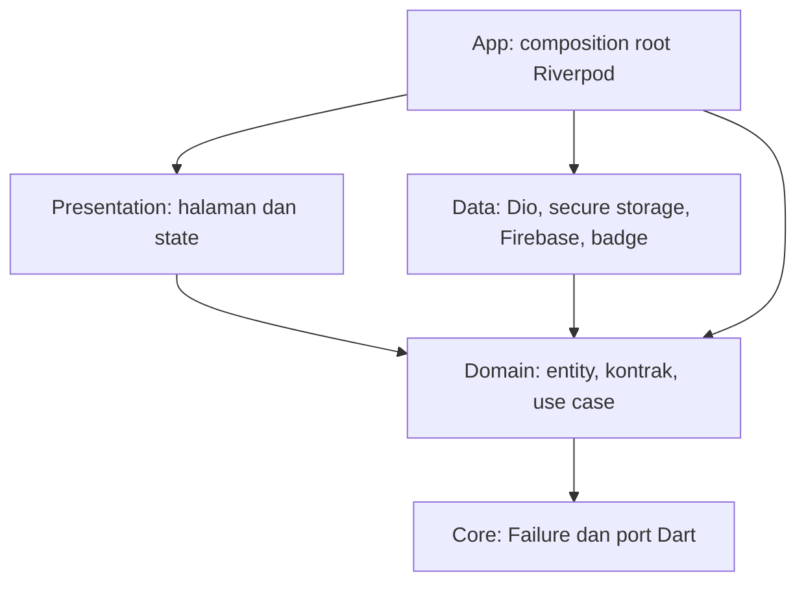

# Refaktor Campus Notify: Clean Architecture dan SOLID

## 1. Acuan dan tujuan

Refaktor ini mengacu pada [materi pertemuan 11](<Minggu 11_Clean_Architecture_Flutter.pptx.pdf>), terutama:

- Slide 6-12: SOLID, dependency rule, feature-first, entity, model, repository, dan use case.
- Slide 14-16: pemetaan file lama dan pencarian pelanggaran dependensi.
- Slide 18-27: domain murni Dart, mapping di data, wiring Riverpod, dan pengujian.
- Slide 29-34: keputusan terhadap usulan AI, menghindari over-engineering, dan bukti verifikasi.

Tujuannya adalah mempertahankan fitur yang sudah berjalan sambil memisahkan tanggung jawab kode. Perubahan ini berfokus pada Flutter `campus_notify`. Backend Laravel, endpoint, skema database, konfigurasi Firebase, dan alamat API tidak diubah dalam refaktor ini.

Clean Architecture adalah pembagian tanggung jawab dan arah dependensi. SOLID adalah prinsip desain kelas dan kontrak di dalam pembagian tersebut. Keduanya tidak cukup diterapkan hanya dengan mengganti nama folder.

## 2. Masalah sebelum refaktor

| Bagian lama | Masalah yang ditemukan | Perbaikan |
| --- | --- | --- |
| `data/auth_repository.dart` | Kontrak, implementasi Dio, entity token, dan parsing JSON berada dalam satu file | Pisahkan `AuthRepository`, `LaravelAuthRepository`, `AuthSession`, dan `AuthSessionModel` |
| `data/notification_repository.dart` | Entity notifikasi masih memiliki `fromJson`; repository belum memiliki abstraksi | Pisahkan entity, model, kontrak, dan `ApiNotificationRepository` |
| `providers/auth_provider.dart` | Wiring SDK, request logout Dio, penyimpanan token, dan state UI tercampur | Wiring dipusatkan di `app/di`; controller menerima dependensi domain; alur bisnis masuk use case |
| `pages/home_page.dart` | Widget membaca token Firebase, menangani exception plugin, dan menyalin clipboard langsung | Pindahkan ke `FirebasePushPreferences`; UI memakai kontrak `PushPreferences` |
| `messaging/badge_service.dart` | Service plugin sekaligus mendeklarasikan provider Riverpod | Implementasi badge di data; provider di composition root |
| `messaging/notification_route.dart` | Parser rute murni bercampur dengan `ChangeNotifier` | Parser di `core/format.dart`; state navigasi di `app/routing` |
| `main.dart` | Bootstrap, router, provider, dan widget aplikasi berada bersama | Pisahkan `main`, `app/bootstrap`, `app/app`, dan `app/routing` |

## 3. Struktur baru

```text
lib/
  main.dart                         # Titik masuk dan inisialisasi Firebase
  app/
    app.dart                        # MaterialApp dan sinkronisasi lifecycle UI
    bootstrap.dart                  # Menghubungkan event push dengan navigasi/inbox
    di/providers.dart               # Composition root: memilih implementasi konkret
    routing/
      app_router.dart               # GoRouter dan penjagaan sesi
      pending_notification_route.dart
  core/                             # Dart murni, tanpa SDK Flutter/Firebase/Dio
    failures.dart
    format.dart                     # Parser/validasi rute notifikasi
    session_expiration.dart         # Sinyal sesi kedaluwarsa
    ports/
      device_session.dart
      notification_badges.dart
  shared/data/network/
    api_config.dart
    api_client.dart                 # Bearer, refresh bersama, retry, expiry
    guard_request.dart              # Exception eksternal menjadi Failure
  features/
    auth/
      domain/
        entities/auth_session.dart
        repositories/
          auth_repository.dart
          session_store.dart
          session_revoker.dart
        usecases/
          login.dart
          logout.dart
          end_session.dart
      data/
        models/auth_session_model.dart
        datasources/secure_token_store.dart
        repositories/
          laravel_auth_repository.dart
          api_session_revoker.dart
      presentation/
        controllers/auth_controller.dart
        providers/auth_provider.dart
        pages/login_page.dart
    announcements/
      domain/
        entities/inbox_notification.dart
        repositories/
          notification_repository.dart
          device_repository.dart
          push_preferences.dart
        usecases/open_notification.dart
      data/
        models/inbox_notification_model.dart
        repositories/
          api_notification_repository.dart
          api_device_repository.dart
        services/
          firebase_push_service.dart
          firebase_push_preferences.dart
          device_sync_service.dart
          platform_badge_service.dart
      presentation/
        providers/notification_providers.dart
        pages/
          home_page.dart
          notifications_page.dart
          announcement_page.dart
```

Fitur `announcements` mencakup pengumuman, inbox notifikasi, registrasi perangkat, preferensi push, dan badge. Ini merupakan satu alur pengumuman kampus yang sudah ada, sehingga belum dipisah menjadi banyak fitur kecil.

`core` hanya menampung kontrak/logika Dart yang dipakai bersama. Dio sengaja diletakkan di `shared/data/network`, sehingga pemeriksaan bahwa `core` bebas framework tetap berlaku.

## 4. Arah dependensi



Panah di atas berarti dependensi kode/import, bukan arah perjalanan respons HTTP. Respons tetap bergerak dari server menuju data, domain, state, dan UI.

Aturannya:

1. Domain tidak mengimpor Flutter, Riverpod, Dio, Firebase, data, atau presentation.
2. Entity tidak melakukan mapping JSON/database. Mapping hanya berada pada model di data.
3. Presentation memakai kontrak/use case domain dan membaca state. Tidak mengimpor implementasi data atau SDK infrastruktur.
4. Data memenuhi kontrak domain dan tidak mengimpor widget/controller maupun composition root.
5. `app/di/providers.dart` adalah pengecualian wiring yang memang mengenal semua implementasi agar bisa merangkainya.

Presentation boleh mengakses deklarasi provider dari composition root atau facade provider. Hal tersebut untuk meminta dependensi yang sudah dirangkai, bukan untuk membuat `Dio()` atau repository konkret di widget.

## 5. Peta setiap file lama

Semua jalur pada tabel berikut relatif terhadap `lib/`.

| File sebelum refaktor | Tujuan setelah refaktor |
| --- | --- |
| `main.dart` | `main.dart`, `app/app.dart`, `app/bootstrap.dart`, `app/routing/app_router.dart` |
| `data/api_config.dart` | `shared/data/network/api_config.dart` |
| `data/api_client.dart` | `shared/data/network/api_client.dart`; menerima kontrak `SessionStore` dan `AuthRepository` |
| `data/token_store.dart` | `features/auth/data/datasources/secure_token_store.dart`; memenuhi `SessionStore` |
| `data/auth_repository.dart` | `features/auth/domain/entities/auth_session.dart`, `domain/repositories/auth_repository.dart`, `data/models/auth_session_model.dart`, dan `data/repositories/laravel_auth_repository.dart` di fitur auth |
| `data/device_repository.dart` | `features/announcements/domain/repositories/device_repository.dart` dan `data/repositories/api_device_repository.dart` |
| `data/notification_repository.dart` | Entity, model, kontrak `NotificationRepository`, dan `ApiNotificationRepository` pada fitur announcements |
| `providers/auth_provider.dart` | `app/di/providers.dart`, controller/facade provider di presentation auth, dan use case auth |
| `providers/notification_provider.dart` | `features/announcements/presentation/providers/notification_providers.dart`; wiring implementasi di `app/di/providers.dart` |
| `pages/login_page.dart` | `features/auth/presentation/pages/login_page.dart` |
| `pages/home_page.dart` | `features/announcements/presentation/pages/home_page.dart`; operasi plugin ke `data/services/firebase_push_preferences.dart` |
| `pages/notifications_page.dart` | `features/announcements/presentation/pages/notifications_page.dart` |
| `pages/announcement_page.dart` | `features/announcements/presentation/pages/announcement_page.dart` |
| `messaging/push_service.dart` | `features/announcements/data/services/firebase_push_service.dart` |
| `messaging/device_sync_service.dart` | `features/announcements/data/services/device_sync_service.dart`; memenuhi port `DeviceSession` |
| `messaging/badge_service.dart` | `features/announcements/data/services/platform_badge_service.dart`; memenuhi port `NotificationBadges`; providernya di composition root |
| `messaging/notification_route.dart` | `core/format.dart` dan `app/routing/pending_notification_route.dart` |

Kontrak tambahan `SessionRevoker` beserta implementasi `ApiSessionRevoker` memisahkan pencabutan sesi melalui client terautentikasi dari login/refresh melalui client publik.

## 6. SOLID pada kode ini

### S - Single Responsibility

- `AuthSession` hanya menyimpan informasi sesi; tidak mengetahui nama field JSON Laravel.
- `AuthSessionModel` membaca `access_token`/`refresh_token` dan mengubahnya menjadi entity.
- `LaravelAuthRepository` berkomunikasi dengan endpoint login/refresh.
- `Login` memastikan token dari login tersimpan sebelum operasi dinyatakan berhasil; token parsial dibersihkan jika penyimpanan gagal.
- `AuthNotifier` mengubah hasil operasi menjadi state loading/data/error bagi UI.
- `LoginPage` mengurus form, validasi isian, dan tampilan.

### O - Open/Closed

Jika sumber pengumuman nanti berpindah dari Laravel ke sumber lain, buat implementasi baru `NotificationRepository`, lalu ubah wiring pada composition root. Entity, `OpenNotification`, dan halaman tidak perlu mengenal SDK sumber data tersebut. Perubahan kontrak bisnis tetap dapat memerlukan perubahan pemanggil; prinsip ini bukan berarti seluruh kode dilarang berubah.

### L - Liskov Substitution

Implementasi nyata dan repository palsu memenuhi kontrak domain yang sama. Misalnya `FakeInbox` dapat menggantikan `ApiNotificationRepository` pada pengujian `OpenNotification` tanpa Flutter plugin, server, atau database sungguhan. Kegagalannya juga memakai tipe `Failure`, sesuai kontrak implementasi nyata.

### I - Interface Segregation

Tidak ada `AppRepository` besar untuk seluruh fitur. Kontrak dipisahkan menjadi `AuthRepository`, `SessionRevoker`, `SessionStore`, `NotificationRepository`, `DeviceRepository`, `PushPreferences`, serta port perangkat dan badge.

Pemisahan login/refresh dari logout penting: client terautentikasi membutuhkan mekanisme refresh, sedangkan pencabutan sesi membutuhkan client terautentikasi. Satu repository yang membuat keduanya saling membaca lewat provider dapat membentuk siklus dependensi. `SessionRevoker` memutus hubungan tersebut.

### D - Dependency Inversion

`Login` menerima `AuthRepository` dan `SessionStore`, bukan `Dio` atau `FlutterSecureStorage`. `OpenNotification` menerima `NotificationRepository`, bukan repository API konkret. `Logout` menerima kontrak pencabutan sesi dan port perangkat; detail SDK tidak masuk domain.

## 7. Contoh alur nyata

### Login

```text
LoginPage -> AuthNotifier -> Login
                             |-> AuthRepository -> LaravelAuthRepository -> API
                             |-> SessionStore -> TokenStore -> secure storage
```

Halaman membaca `AsyncValue<bool>`. `Login` tidak mengetahui Riverpod. Controller memulai sinkronisasi perangkat setelah login berhasil, menggunakan port `DeviceSession`.

### Membuka notifikasi

```text
Klik daftar/banner -> GoRouter -> AnnouncementPage
  -> notificationDetailsProvider -> OpenNotification
  -> fetch detail -> markAsRead -> invalidate daftar belum dibaca
```

`OpenNotification` diperlukan karena ada urutan operasi dan aturan: detail harus berhasil diambil sebelum pesan ditandai dibaca. Jika halaman/sesi sudah tidak aktif setelah fetch, pesan tidak ditandai dibaca. Jika terjadi kegagalan, state detail menjadi error dan pengguna dapat mencoba lagi.

### Logout dan sesi kedaluwarsa

`Logout` melepas registrasi perangkat lebih dahulu, meminta pencabutan sesi server, kemudian selalu memanggil `EndSession`. `EndSession` menghentikan sinkronisasi perangkat, menghapus token lokal, dan membersihkan badge/banner. Jika server gagal dihubungi, logout melaporkan `false` agar UI tetap memberi informasi bahwa pencabutan server belum terkonfirmasi.

Interceptor tetap membatasi retry dan berbagi satu proses refresh untuk request bersamaan. Saat sesi kedaluwarsa, network memanggil `SessionExpiration`, lalu listener controller mengakhiri sesi. Network tidak membaca provider controller secara langsung, sehingga arah dependensi tidak melingkar.

## 8. Contoh dependency injection

Potongan yang setara dengan wiring pada `app/di/providers.dart`:

```dart
final notificationRepositoryProvider = Provider<NotificationRepository>(
  (ref) => ApiNotificationRepository(ref.watch(apiClientProvider)),
);

final openNotificationProvider = Provider<OpenNotification>(
  (ref) => OpenNotification(ref.watch(notificationRepositoryProvider)),
);
```

UI meminta provider dan menerima entity domain. Pada test, provider repository dapat di-override dengan fake. Pemilihan implementasi konkret tidak ditulis di widget.

`AsyncNotifier` baru memperoleh `Ref` ketika `build()` berjalan. Karena itu, composition root memberikan resolver `AuthDependencies` ke constructor controller; resolver tersebut mengambil use case dan kontrak melalui Riverpod ketika build. Controller tetap tidak mengimpor kelas implementasi data.

## 9. Failure dan pilihan desain

Data layer mengubah exception Dio, parsing, storage, dan plugin menjadi `Failure` yang aman. UI memakai `failureMessage()` atau `failure.message`, tanpa menampilkan response mentah, token, atau detail exception SDK.

Materi memberi contoh record `({data, failure})`. Implementasi ini memilih `Failure implements Exception` dengan `Future<Entity>` dan `AsyncValue` agar sesuai alur Riverpod yang sudah dipakai. Ini adalah penyesuaian terhadap bentuk contoh slide; tujuan pemisahannya tetap sama: domain dan UI tidak menerima exception SDK mentah. Tidak ditambahkan package Either/Result baru.

Daftar belum dibaca hanya membutuhkan satu operasi CRUD. Providernya memanggil kontrak `NotificationRepository` langsung. Tidak dibuat kelas `GetUnreadNotifications` yang hanya meneruskan satu baris. Hal ini mengikuti pembahasan penggunaan use case pada slide 22 dan checklist slide 30.

Repository API langsung memakai Dio dan model, tanpa membuat remote data source tambahan yang hanya meneruskan request. Secure storage tetap memiliki implementasi tersendiri karena merupakan sumber data berbeda dan perlu dapat diganti dengan penyimpanan palsu pada pengujian.

## 10. Catatan AI Challenge

### Prompt pengguna

> Pelajari file pertemuan 11 di folder docs tentang clean architecture, lalu rubah struktur project ini supaya menggunakan struktur SOLID, lalu berikan penjelasan dengan membuat file md.

### Usulan awal AI

Usulan yang disampaikan sebelum implementasi: gunakan fitur `auth` dan `announcements`, pisahkan kontrak domain dari implementasi API/plugin, pusatkan wiring Riverpod, dan gunakan use case untuk login, logout, serta membuka notifikasi.

### Usulan dan keputusan implementasi

Tabel ini mencatat keputusan teknis yang diterapkan AI pada kode; bukan pernyataan bahwa pengguna sudah meninjau atau menyetujui setiap keputusan secara individual.

| Usulan | Keputusan yang diterapkan | Alasan / trade-off |
| --- | --- | --- |
| Feature-first untuk auth dan announcements | Diterapkan | Fitur dapat dipahami bersama data, domain, dan presentation-nya |
| Interface domain dan implementasi data terpisah | Diterapkan | Memungkinkan penggantian sumber data dan fake saat test |
| Semua operasi memiliki use case | Disederhanakan | Hanya alur multi-operasi/beraturan yang mendapat use case; CRUD sederhana langsung memakai kontrak |
| SDK bersama diletakkan di core | Tidak diterapkan | Core dijaga murni Dart; Dio berada di `shared/data/network` |
| Membuat fitur terpisah untuk push, perangkat, badge, dan inbox | Belum diperlukan | Semuanya masih mendukung satu alur pengumuman kampus |
| Record hasil seperti contoh slide | Disesuaikan menjadi typed Failure | Lebih sedikit perubahan pada AsyncValue; batas data tetap menerjemahkan exception |
| Mapping dilakukan entity | Tidak diterapkan | Entity murni; model data memiliki `fromJson()` dan `toEntity()` |
| Network membaca controller saat sesi habis | Tidak diterapkan | Memakai sinyal `SessionExpiration` untuk menghindari siklus dependensi |

## 11. Verifikasi

Tiga pencarian berikut dijalankan dari root project. Semuanya menghasilkan **0 kecocokan**. `rg` mengembalikan exit code 1 ketika tidak ada kecocokan; itu merupakan hasil yang diharapkan untuk pemeriksaan ini.

```powershell
rg -n 'Dio\(|openDatabase|FlutterSecureStorage|SharedPreferences|jsonDecode|FirebaseMessaging|Clipboard\.' lib/features/auth/presentation lib/features/announcements/presentation

rg -n 'package:(flutter|flutter_riverpod|dio|firebase|sqflite|flutter_secure_storage)' lib/core lib/features/auth/domain lib/features/announcements/domain

rg -n '(fromJson|toJson|fromMap|toMap)\s*\(' lib/features/auth/domain/entities lib/features/announcements/domain/entities
```

Verifikasi otomatis:

| Pemeriksaan | Hasil |
| --- | --- |
| `dart format lib test` | Format disesuaikan |
| `dart analyze lib test` | Tanpa error/warning; 5 info deprecated pada API token Firebase yang sudah digunakan sebelumnya |
| `flutter test --no-pub` | 36 test lulus |
| Test aturan dependensi | 4 test: domain/core, presentation, data, dan entity |
| Test use case dengan fake | 7 test: login sukses/gagal, rollback token parsial, membuka notifikasi, fetch gagal, halaman ditinggalkan, dan logout offline |
| Test regresi lama | Login API, storage, rotasi token, concurrency refresh, guard route, navigasi klik notifikasi, logout, dan form |

Tes menggunakan HTTP adapter, repository palsu, dan mock storage. Tidak mengirim push atau menghubungi Laravel/Firebase sungguhan. API `getToken()`/`onTokenRefresh` dipertahankan dalam refaktor struktur ini; migrasi SDK bukan bagian dari perubahan ini.

### Pengujian perangkat yang perlu diulang

1. Jalankan ulang aplikasi sepenuhnya dengan `API_BASE_URL` yang sama seperti sebelumnya.
2. Uji login benar/salah, tutup-buka aplikasi, dan logout.
3. Kirim dua notifikasi lewat command Laravel yang sudah tersedia.
4. Uji penerimaan pada foreground, background, dan terminated tanpa Force stop.
5. Buka pesan dari daftar dan banner; pastikan detail sesuai dan pesan hilang dari daftar belum dibaca.
6. Periksa badge dalam aplikasi dan ikon HP sesuai dukungan launcher.
7. Uji koneksi terputus dan tombol coba lagi.

Pengujian pada HP setelah refaktor dan screenshot before/after belum dilakukan dalam pengerjaan ini. Simpan bukti aktual ke folder `screenshots/` saat mengulang pengujian; jangan memasukkan token lengkap atau kredensial. Build APK tidak dijalankan ulang pada refaktor ini.

## 12. Cara menjelaskan saat demo

Contoh penjelasan singkat:

> Halaman hanya membaca state. State memanggil use case atau kontrak repository di domain. Implementasi repository berada di data dan memakai Dio atau plugin. Provider di composition root memasangkan kontrak dengan implementasi. Jika sumber data diganti, domain dan halaman tidak perlu mengetahui detail sumber barunya.

Tunjukkan `OpenNotification` sebagai contoh aturan bisnis, `InboxNotificationModel` sebagai contoh mapping, dan `app/di/providers.dart` sebagai contoh dependency injection. Jalankan test use case untuk menunjukkan bahwa aturan bisnis bisa diuji tanpa server atau perangkat.
